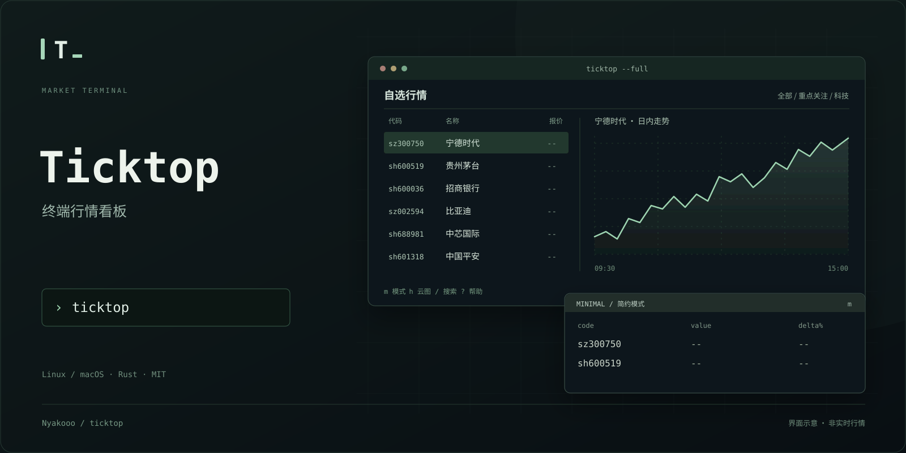

# Ticktop



**在终端里看行情、管理自选、浏览板块云图。** 免费数据源，无需行情账号或 API Key，只看盘，不交易。

- **自选分组**：中文、股票代码、拼音都能搜，把关注的股票分组保存。
- **两种模式**：完整模式看走势与色块，简约模式看股票代码、板块名称和数字；自动记住上次选择。
- **大盘云图**：行业 / 概念板块全量浏览，支持排序、翻页和鼠标查看详情。

按 `/` 可搜索股票、ETF 或指数；按 `i` 配置顶部常驻指数，默认显示上证指数，设置自动保存。

个股详情新增**筹码峰（估算）**：完整模式看分布，简约模式看均价和成本区间。免费日线源可能不可用，计算口径见[使用指南](docs/GUIDE.md#筹码峰本地估算)。

## 下载与安装

支持 **Linux / macOS**，下载对应版本即可使用，无需安装 Rust。当前支持 A 股、沪深 ETF 和常用指数（含恒生指数）。

| 系统 | 芯片架构 | 下载 | 校验 |
| --- | --- | --- | --- |
| Linux | x86_64 / AMD64 | [下载](https://github.com/Nyakooo/ticktop/releases/download/v0.2.0/ticktop-x86_64-unknown-linux-musl.tar.gz) | [SHA-256](https://github.com/Nyakooo/ticktop/releases/download/v0.2.0/ticktop-x86_64-unknown-linux-musl.tar.gz.sha256) |
| Linux | ARM64 / AArch64 | [下载](https://github.com/Nyakooo/ticktop/releases/download/v0.2.0/ticktop-aarch64-unknown-linux-musl.tar.gz) | [SHA-256](https://github.com/Nyakooo/ticktop/releases/download/v0.2.0/ticktop-aarch64-unknown-linux-musl.tar.gz.sha256) |
| macOS | Intel | [下载](https://github.com/Nyakooo/ticktop/releases/download/v0.2.0/ticktop-x86_64-apple-darwin.tar.gz) | [SHA-256](https://github.com/Nyakooo/ticktop/releases/download/v0.2.0/ticktop-x86_64-apple-darwin.tar.gz.sha256) |
| macOS | Apple Silicon（M 系列） | [下载](https://github.com/Nyakooo/ticktop/releases/download/v0.2.0/ticktop-aarch64-apple-darwin.tar.gz) | [SHA-256](https://github.com/Nyakooo/ticktop/releases/download/v0.2.0/ticktop-aarch64-apple-darwin.tar.gz.sha256) |

解压后，在终端进入解压目录，运行 `./ticktop`。

也可以一键安装到 PATH：

```bash
curl -fsSL https://raw.githubusercontent.com/Nyakooo/ticktop/master/scripts/install.sh | bash
```

安装后按提示重新打开终端，输入 `ticktop` 即可。更新使用 `ticktop update`。

## 怎么用

第一次打开，按 `a` 搜索并添加股票，例如输入「宁德」、`300750` 或 `ningde`。

| 操作 | 按键 |
| --- | --- |
| 搜索 / 添加自选 | `/` / `a` |
| 管理 / 切换自选分组 | `g` / `[` `]` |
| 切换完整 / 简约模式 | `m` |
| 切换自选行情 / 大盘云图 | `h` |
| 云图切行业、概念 / 切排序 | `Tab` / `s` |
| 云图翻页 | `PgUp` `PgDn`，或 `p` `n` |
| 设置常驻指数 | `i` |
| 设置代理和刷新间隔 | `,` |
| 帮助 / 退出 | `?` / `q` |

方向键选择股票或板块。云图也支持鼠标悬停、点击和滚轮翻页。窗口建议至少 120 列 × 35 行。

## 了解更多

[完整使用指南](docs/GUIDE.md) · [配置与代理](docs/GUIDE.md#配置) · [数据来源](docs/GUIDE.md#免费数据与边界) · [开发与验证](docs/GUIDE.md#开发与验证) · [MIT License](LICENSE)

免费行情可能延迟，休市时显示最后可用数据。云图面积按成分股数量分配，颜色表示板块平均涨跌幅，具体口径见使用指南。
